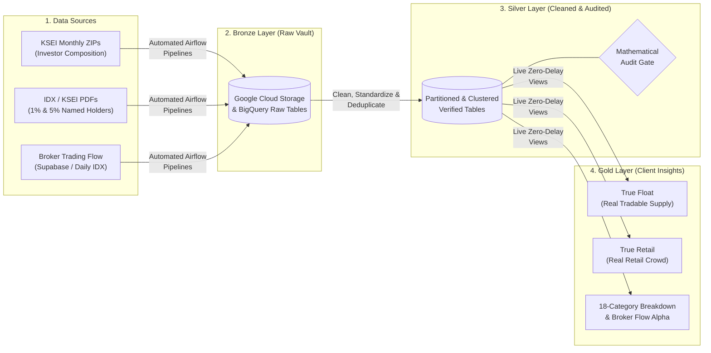

# IDX Ownership & Market Flow Intelligence Platform
**Client Project Overview & Progress Report**

---

## 1. Executive Summary
We have built and deployed an automated, cloud-native **Indonesian Stock Exchange (IDX) Ownership & Institutional Flow Data Platform** on **Google Cloud Platform (GCP)**. 

Previously, analyzing who truly owns an Indonesian stock—and tracking how big institutional brokers accumulate or distribute shares—required running fragile manual scripts on a local computer, juggling intermediate spreadsheets, and querying a slow, capacity-constrained database (Supabase). Furthermore, standard public stock market numbers are often misleading because they lump company founders in with everyday retail investors and count locked, untradable shares as "free float."

**What this platform delivers:**
- **100% Automated Regulatory & Market Data Collection**: Automatically captures monthly KSEI investor composition data across all **1,002 listed IDX stocks**, parses 70+ page regulatory PDF disclosures (both 5% and 1% OJK rules), and ingests daily broker trading activity (**186,558+ historical records** migrated).
- **True Ownership Transparency ("True Float" & "True Retail")**: Separates locked founder shares and wealthy insiders from real tradable market supply and genuine retail crowd ownership.
- **Zero-Defect Mathematical Verification**: Every single stock is audited automatically down to the exact share before data is published to dashboards.
- **Enterprise Cloud Scale at Near-Zero Cost**: Powered by Google Cloud Storage, BigQuery, and Cloud Composer (Apache Airflow)—delivering sub-second (<0.4s) queries while cutting database scan costs by ~90%.

---

## 2. The Business Problem We Solved

When analyzing Indonesian equities, raw public data from KSEI and IDX presents three major blind spots:

| Blind Spot in Raw Public Data | Why It Misleads Investors | How Our Platform Solves It |
| :--- | :--- | :--- |
| **1. "Fake" Free Float** | Many companies have millions of **non-scripless (physical/locked)** shares held outside KSEI, plus strategic stakes between **1% and 5%** that never trade. Standard data counts these as tradable supply. | Our **True Float** engine isolates only scripless shares actively circulating inside KSEI and subtracts every named insider holding $\ge 1\%$. |
| **2. "Whales" Disguised as Retail** | KSEI reports a category called "Local Individuals" (`LOCAL_ID`). However, company founders, tycoons, and family insiders who hold shares under their personal names are lumped into this exact same bucket. | Our **True Retail** engine cross-references KSEI totals against named individual disclosures ($\ge 1\%$) and strips out the billionaires—revealing the **real retail crowd**. |
| **3. Changing OJK Rules & Messy Formats** | Monthly KSEI files mix 3,600+ bonds, warrants, and stocks in pipe-delimited text files, while 1% and 5% shareholder disclosures arrive as 70+ page PDFs with changing layouts and Indonesian number formatting (`3.200.142.830` and `41,10%`). | Our automated **Dual-Format PDF & Text Parsers** detect layout changes automatically, standardize every number, and reconcile them in seconds. |

---

## 3. How the System Works (In Simple Terms)

We organized the platform using the industry-standard **Medallion Architecture (Bronze → Silver → Gold)** inside Google BigQuery (`asia-southeast2` Jakarta region), orchestrated automatically by **Google Cloud Composer (Managed Airflow)** and **GitHub Actions**.

1. **Bronze Layer (`idx_raw` — The Digital Vault)**
   - Every raw file (KSEI text exports, 1%/5% PDF tables, and historical broker summaries) is stored untouched in Google Cloud Storage and loaded into raw BigQuery tables with a timestamp and source filename.
   - *Client Benefit*: We never lose historical data, and if regulations change, we can reprocess years of history in minutes without re-downloading anything.

2. **Silver Layer (`idx_analytics` — Cleaned, Verified & Fast)**
   - Automated SQL pipelines filter out non-stocks (removing 2,632 bonds, warrants, and mutual funds to focus strictly on the **1,002 listed equities**), convert Indonesian text formatting into clean numbers, and organize tables by **Date** and **Stock Ticker**.
   - *Client Benefit*: Dashboards load in **under 0.4 seconds** and scan 90% less data, keeping cloud bills under the free tier.

3. **Gold Layer (`idx_analytics` Views — Ready-to-Use Intelligence)**
   - Live analytical views sit directly on top of the Silver tables. The moment new monthly or daily data arrives, every client metric updates automatically with zero manual work.

---

## 4. Complete Breakdown of What Has Been Built (Chronological Deliverables)

Across our engineering sessions, we completed five major milestones:

### Milestone 1: Cloud Foundation & KSEI Investor Composition Pipeline
*Sessions 1 & 3*
- **Cloud Infrastructure Setup**: Established the dedicated GCP environment (`project-99693d37-acaf-4ebd-86c` in Jakarta `asia-southeast2`), raw data lake bucket (`gs://idx-ksei-raw-data`), and BigQuery datasets (`idx_raw` and `idx_analytics`).
- **KSEI Balancepos Pipeline ([`run_ksei_pipeline.py`](file:///g:/Dean/Saham%20IDX/research-gcp/scripts/run_ksei_pipeline.py) & [`scrape_ksei.py`](file:///g:/Dean/Saham%20IDX/research-gcp/src/bandarmology/extractors/scrape_ksei.py))**:
  - Automatically downloads monthly KSEI ZIP archives (`BalanceposYYYYMMDD.zip`), stepping backward automatically if the last day of the month falls on a weekend or holiday.
  - Filters **3,634 total KSEI securities** down to the **1,002 active IDX equities (`EQUITY`)**.
  - Maps all **18 institutional and retail categories** (9 Local + 9 Foreign: Insurance, Corporate, Pension Fund, Bank, Individual, Mutual Fund, Securities, Foundation, Others).
- **100% Mathematical Data Quality Gate ([`dq_ksei_composition_audit.sql`](file:///g:/Dean/Saham%20IDX/research-gcp/bigquery/marts/dq_ksei_composition_audit.sql))**:
  - Automatically checks every single stock against three accounting rules:
    1. Sum of 9 Local categories = Reported Local Total (**0 mismatches across 1,002 stocks**).
    2. Sum of 9 Foreign categories = Reported Foreign Total (**0 mismatches across 1,002 stocks**).
    3. Total Scripless Shares in KSEI $\le$ Total Issued Shares (**100% verified**).

### Milestone 2: Automated 1% & 5% Shareholder PDF Disclosure Engine
*Session 2*
- **Replaced Manual CSV Workarounds**: Eliminated three separate legacy scripts that previously required manual intervention and local intermediate CSV files.
- **Dual-Format PDF Extractor ([`pdf_shareholders.py`](file:///g:/Dean/Saham%20IDX/research-gcp/src/bandarmology/extractors/pdf_shareholders.py) & [`run_shareholders_pipeline.py`](file:///g:/Dean/Saham%20IDX/research-gcp/scripts/run_shareholders_pipeline.py))**:
  - Automatically reads raw KSEI/IDX PDF files (`lamp1.pdf`) and detects whether the file uses the **legacy 5% SID format** (e.g., Jan 2026) or the **new expanded 1% OJK format** (e.g., Mar 2026 with **6,851 rows** and Apr 2026 with **5,247 rows**).
  - Standardizes Indonesian numbers, cleans entity names, maps investor status codes into standardized categories, and deduplicates exact holdings into [`ksei_shareholder_ownership`](file:///g:/Dean/Saham%20IDX/research-gcp/bigquery/silver/04_transform_shareholder_ownership.sql).

### Milestone 3: The "Gold" Analytical Marts (Client Insights)
*Session 2*
We built five core analytical views in BigQuery (`bigquery/marts/`) that power instant client insights:
1. **True Float ([`mart_true_float.sql`](file:///g:/Dean/Saham%20IDX/research-gcp/bigquery/marts/mart_true_float.sql))**:
   - Properly separates **Non-Scripless / Locked Shares** (shares held outside KSEI) from **KSEI Scripless Shares**, then subtracts all named insiders holding $\ge 1\%$ inside KSEI to reveal the exact number of shares actually available to trade on the open market.
2. **True Retail ([`mart_true_retail.sql`](file:///g:/Dean/Saham%20IDX/research-gcp/bigquery/marts/mart_true_retail.sql) & [`mart_true_retail_dominance.sql`](file:///g:/Dean/Saham%20IDX/research-gcp/bigquery/marts/mart_true_retail_dominance.sql))**:
   - Subtracts named high-net-worth individuals (`LOCAL_ID` $\ge 1\%$) from KSEI's aggregate local individual bucket, showing what percentage of the real free float is controlled by everyday retail traders.
3. **Complete 18-Category Shareholder Breakdown ([`mart_complete_shareholder_breakdown.sql`](file:///g:/Dean/Saham%20IDX/research-gcp/bigquery/marts/mart_complete_shareholder_breakdown.sql))**:
   - Combines named 1%/5% shareholders with the calculated remainder (`<1%` or `<5%` unnamed holders) across all 18 Local & Foreign categories so every stock adds up to **100.00%** without double-counting.
4. **Combined Executive Summary ([`mart_true_float_and_retail.sql`](file:///g:/Dean/Saham%20IDX/research-gcp/bigquery/marts/mart_true_float_and_retail.sql))**:
   - A single unified table joining True Float, True Retail, Locked Non-Scripless Shares, and Named Strategic Holdings for every ticker and month.
5. **Automated Gold Verification ([`verify_gold_layer.sql`](file:///g:/Dean/Saham%20IDX/research-gcp/bigquery/marts/verify_gold_layer.sql))**:
   - Runs automated sanity checks ensuring `0% <= True Float <= 100%` and `True Retail Shares <= True Float Shares`.

#### Real Examples from Our Verified Gold Layer:
| Stock Ticker | Total Issued Shares | Locked / Non-Scripless (Outside KSEI) | Named Insiders in KSEI ($\ge 1\%$) | **True Tradable Float** | **True Retail Ownership** | Key Insight for Client |
| :--- | :---: | :---: | :---: | :---: | :---: | :--- |
| **BBCA** | 123.28B | 1.38B (1.1%) | 78.65B (63.8%) | **35.08%** (43.25B) | **4.64%** (5.72B) | Highly liquid institutional stock; foreign institutions hold the vast majority of the float, while retail holds only 4.64%. |
| **BREN** | 133.79B | 16.05B (12.0%) | 109.18B (81.6%) | **6.40%** (8.56B) | **1.16%** (1.56B) | Tightly controlled supply; 93.6% is locked in non-scripless or named strategic hands, leaving only 6.40% true float. |
| **DCII** | 2.38B | 0.99B (41.4%) | 1.24B (52.0%) | **6.57%** (0.16B) | **1.00%** (0.02B) | Over 41% of the company doesn't even exist in KSEI scripless form, and founders hold personal stakes inside KSEI—true float is just 6.57%. |

### Milestone 4: Cloud Composer (Airflow) Automation & Architecture Cleanup
*Sessions 3 & 4*
- **Self-Contained Airflow Pipelines**:
  - [`dag_ksei_monthly_balancepos.py`](file:///g:/Dean/Saham%20IDX/research-gcp/dags/dag_ksei_monthly_balancepos.py): Runs on the 2nd of every month—automatically scrapes KSEI, uploads to GCS, loads Bronze, merges Silver, runs the Mathematical Audit Gate, and **auto-detects & backfills any missing historical months**.
  - [`dag_ksei_monthly_shareholders_1pct.py`](file:///g:/Dean/Saham%20IDX/research-gcp/dags/dag_ksei_monthly_shareholders_1pct.py): Automates the monthly 1%/5% shareholder disclosure transformation and data quality audit.
  - [`dag_daily_broker_summary.py`](file:///g:/Dean/Saham%20IDX/research-gcp/dags/dag_daily_broker_summary.py): Orchestrates daily after-market broker flow ingestion and updates [`mart_broker_event_study.sql`](file:///g:/Dean/Saham%20IDX/research-gcp/bigquery/marts/mart_broker_event_study.sql).
- **CI/CD Deployment (`.github/workflows/`)**: Every code update is automatically tested for syntax/import errors (`test_dags.yml`) and synced straight to Cloud Composer (`deploy_dags.yml`).
- **Focused Scope Cleanup**: Per project alignment, we stripped out unused experimental bloat—specifically removing intraday tick-by-tick (`done_detail`) and legacy Wyckoff regime screener scripts—keeping the platform 100% focused on **Ownership Intelligence & Daily Broker Flow**.

### Milestone 5: Full Historical Broker Summary Migration (Completed Today)
*Session 5*
- **Supabase-to-BigQuery Migration ([`dag_supabase_broker_summary_migration.py`](file:///g:/Dean/Saham%20IDX/research-gcp/dags/dag_supabase_broker_summary_migration.py))**:
  - Built and executed a high-efficiency migration pipeline in Cloud Composer to move historical `broker_summary` trading data out of the legacy Supabase PostgreSQL database (`ResearchBDM`) and into Google BigQuery.
  - Solved cloud networking constraints (routing around IPv6 restrictions using Supabase's IPv4 Session Pooler with SSL encryption) and engineered **25,000-row server-side cursor streaming** so Airflow workers never run out of memory.
  - **100% Completed**: All **186,558 historical broker summary rows** have been compressed into GCS Parquet files and loaded cleanly into BigQuery (`idx_raw.broker_summary`), verified against the source database row count.

---

## 5. Project Status & Immediate Next Steps

| Component / Workstream | Status | Key Outcome |
| :--- | :---: | :--- |
| **GCP Infrastructure & Medallion Warehouse** | **COMPLETED** | BigQuery Bronze/Silver/Gold + GCS Data Lake live in Jakarta (`asia-southeast2`) |
| **KSEI Monthly Composition Pipeline (1,002 Stocks)** | **COMPLETED** | Automated scraper, Silver merge, missing-month backfill, 100% DQ audit pass |
| **1% & 5% Shareholder PDF Disclosure Engine** | **COMPLETED** | Auto-detects 5% and 1% PDF formats; 12,000+ named records parsed & verified |
| **Gold Analytical Views (True Float & True Retail)** | **COMPLETED** | Live views separating locked scrip, insiders, true float, and true retail |
| **Historical Broker Summary Migration (186,558 Rows)** | **COMPLETED** | Streamed from Supabase PostgreSQL to GCS Parquet & BigQuery via Airflow |
| **Daily Broker Flow & Price Summary Mapping DAGs** | **NEXT STEP** | Connect daily EOD price/broker updates & Silver/Gold broker accumulation marts |

### What Is Next on the Roadmap:
1. **Migrate Remaining Daily Stock Price Summary (`stock_daily_summary`)**: Move the companion daily OHLCV/foreign-flow table (78,782 rows) from Supabase into BigQuery so broker accumulation can be paired with forward stock returns entirely inside BigQuery.
2. **Automated Broker Flow Silver & Gold Transformation DAGs**: Schedule automated BigQuery transformations on top of `idx_raw.broker_summary` to calculate Top 3 / Top 5 institutional net buy/sell concentration and power client dashboards.
